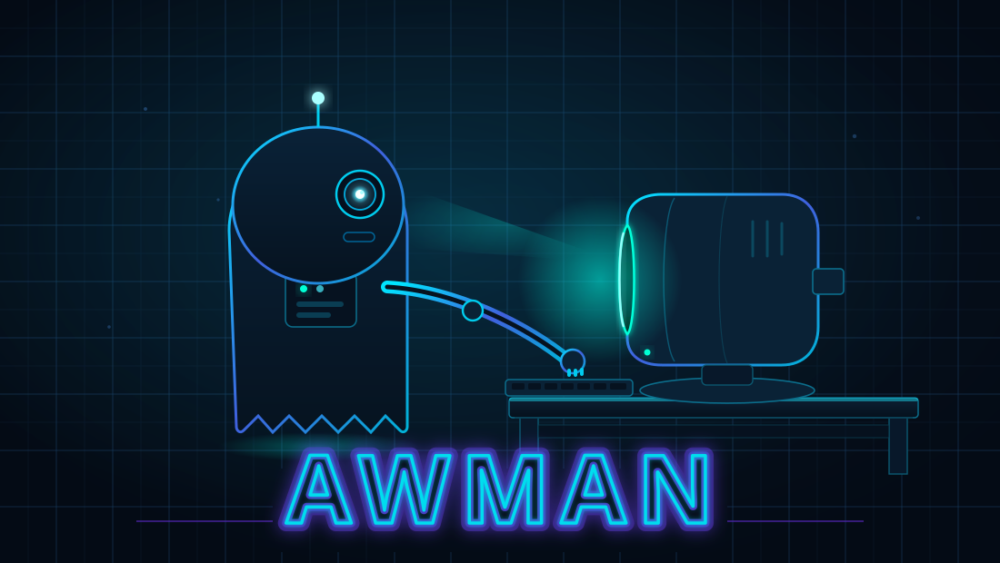
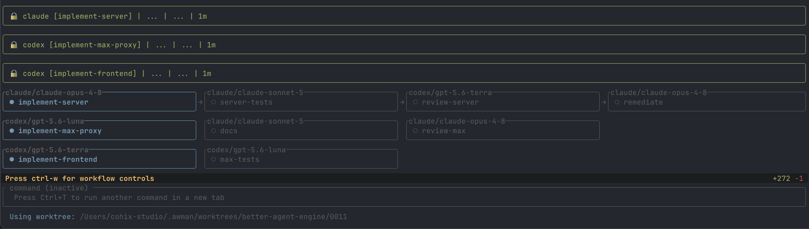

<p align="center">
  
</p>

# awman

[](https://github.com/prettysmartdev/awman/actions/workflows/test.yml)

**Custom agent workflows for your hardest tasks, run safely in isolation.**

awman is an Agent Workflow Manager that turns agent best practices like clear specs, independent review, tests, and autoremediation into a repeatable workflow for developers. Give it a work item: awman's leader agent designs a custom workflow, then awman validates and runs it in isolated containers or microVMs on your laptop, server, cloud VM, or homelab. Shared context carries decisions between agents, and the run can finish with a PR and passing CI. Bring Claude Code, Codex, OpenCode, or your preferred code agent.



## Make quality repeatable

- **Give each task a process.** A work item sets the goal; [dynamic mode](docs/06-dynamic-workflows.md) designs a workflow for it, or you can [define it yourself](docs/05-workflows.md). awman validates the workflow before running its steps in isolation.
- **Make review independent.** Put implementation, review, and verification in separate steps, with different agents or models if you choose. The change gets challenged before it reaches your PR.
- **Keep decisions in the loop.** Dynamic workflows pass plans, notes, and intermediate results through shared [workflow context](docs/08-overlays.md#workflow-context). Later agents can build on earlier findings instead of rediscovering them.
- **Fix the failing step.** Saved workflow state lets you retry, step back, or resume when things go sideways. Add [`on_failure` agents](docs/05-workflows.md#step-remediation-with-on_failure) to automatically diagnose and fix a failed test or CI check and retry it.

## Keep the run contained and reviewable

- **Isolation makes autonomy practical.** Agents see the mounted project; [overlays](docs/08-overlays.md) grant extra directories, skills, or environment variables only where needed. Local dynamic runs use a Git worktree, remote runs use an isolated clone.
- **Carry checks through to PR.** Workflow steps can run required tests, commit and push changes, open a PR, and wait for CI. Failing checks can automatically trigger a fix agent.
- **Apply the same bar to recurring work.** [Squad](docs/12-squad.md) can watch new issues or failing PRs and launch workflows on a schedule. The [daemon API](docs/09-api-and-remote-mode.md) supports scripts and remote workers.

## One engine, five ways to use it

Use the [CLI](docs/14-command-reference.md) for scripts, the [TUI](docs/02-using-the-tui.md) for live oversight, the [API](docs/09-api-and-remote-mode.md) for integrations, the [web app](docs/20-webapp.md) for local browser control, or a [worker](docs/17-workers-and-work-servers.md) to claim jobs from a work server. Each path uses the same workflow engine and isolated agent execution.

## Get started

You'll need a Git repository, an account for your chosen agent, and a supported runtime such as Docker, Apple Containers, Docker sbx, or the builtin microVM runtime: [supported runtimes](docs/11-runtimes.md).

```sh
curl -s https://prettysmart.dev/install/awman.sh | sh
cd your-repo
awman init --agent codex
awman ready
awman new spec --interview
```

`init` prepares the project; `ready` checks the runtime and agent authentication. `new spec --interview` turns your task summary into a numbered work item. Use the number it prints to run your first dynamic workflow:

```sh
awman exec workflow --dynamic --work-item 0042
```

Replace `0042` with your work-item number. awman generates the workflow and runs it autonomously in a separate Git worktree.

## Other ways to work

| Goal | Command |
|---|---|
| [Define the steps yourself](docs/05-workflows.md) | `awman exec workflow path/to/workflow.toml --issue 84 --worktree` |
| [Run a one-off prompt](docs/03-agent-sessions.md) | `awman exec prompt "Review this change for bugs"` |
| [Work directly with an agent](docs/03-agent-sessions.md) | `awman chat` |
| [Turn a GitHub issue into a work item](docs/10-github-integration.md) | `awman new spec --issue 84` |
| [Set up recurring squad work](docs/12-squad.md) | `awman squad add --interview` |
| [Watch and manage live sessions](docs/02-using-the-tui.md) | `awman` |
| [Serve work through the API](docs/09-api-and-remote-mode.md#running-the-api-server) | `awman config set daemon.features.worker.enabled true`<br>`awman config set daemon.features.worker.push.workDirs.allow "$PWD"`<br>`awman daemon start --background` |
| [Pull jobs from a work server](docs/17-workers-and-work-servers.md#link-a-work-server) | `awman link https://work.example.com --name team` |

## Documentation

[Getting started](docs/00-getting-started.md) · [Security and isolation](docs/04-security-and-isolation.md) · [Web app](docs/20-webapp.md) · [Command reference](docs/14-command-reference.md) · [License](LICENSE)
